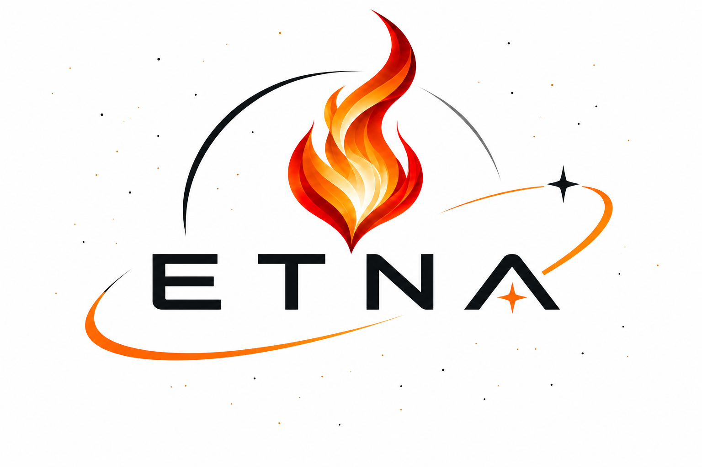

<p align="center">
  <picture>
    <source media="(prefers-color-scheme: dark)" srcset="web/public/img/etna-logo-dark.png">
    
  </picture>
</p>

# Etna

**Fire safety for the Moon, Mars and the ISS, built on what NASA actually measured in space.**
NASA Space Apps Challenge 2026 · Challenge: *Flame in Freefall*

**▶ Live app: https://etna.web.app**

## The problem

Fire behaves differently in microgravity. Hot air does not rise, so flames become dim blue balls and smoke may never reach a detector. Future Moon habitats and rovers plan to use air with more oxygen at lower pressure, which makes fires start more easily.

NASA has run many fire experiments on the ISS, but the results are scattered across hundreds of spreadsheets and PDF reports in its PSI repository. Etna brings them together so anyone can see what is known about fire in a given habitat, and what is not.

## What the app does

- **Pick a habitat** (ISS, Moon habitat, pressurized rover, Mars habitat) and see the NASA experiments ranked by how many tests were run in that habitat's air.
- **Browse experiments** by what burned (solids, droplets, gas flames, smoke) and by safety goal (prevention, detection, suppression). Each study shows its findings with links to the NASA source, and its test data can be downloaded as CSV.
- **Coverage map** of every test by oxygen and pressure, showing the gaps. For example, only 20 tests fall inside Moon-habitat air.
- **Knowledge graph** connecting experiments, materials, fuels, habitats and hardware.
- **Search** NASA reports in your own words, with the report and page for each result.
- **Predict** whether an acrylic rod keeps burning, using NASA's own flammability boundary.
- **Flame Lab**: a 3D burning droplet that behaves like the closest real NASA tests, with a trust badge on every prediction.
- **Ask Etna**: a chat assistant that answers from the NASA reports and data and cites its sources.
- **My reports**: upload your own PDF, chat with it, and review an AI-drafted study card.
- **Mir 1997**: an interactive history lesson on the 1997 fire aboard the Mir space station.
- **Three levels** of explanation: Explorer, Student and Researcher.

**Honesty first:** every NASA spaceflight test was run in microgravity. Nothing was tested at Moon or Mars gravity, so Etna shows that as a gap instead of guessing.

## How it is built

| Part | Tools |
|---|---|
| Frontend (`web/`) | React, Vite, Three.js, d3 |
| Backend (`app/`) | Python, FastAPI |
| Database | PostgreSQL with pgvector (Neon) |
| Assistant | `gpt-oss-120b` on Groq, through Agno |
| Search | BGE-M3 embeddings |
| Data pipeline (`scripts/`) | Download, clean and train on NASA PSI data |
| Hosting | Google Cloud Run + Firebase Hosting |

## Use of AI

AI coding assistants helped us write parts of the code and documentation, but they did not build the whole app. The team designed the app, wrote much of the code, cleaned and checked the NASA data, and reviewed and tested everything.

Inside the app, AI is used only for the chat assistant, report search and draft cards for uploaded reports. All numbers, rankings, maps and predictions come straight from NASA's data, not from AI.

## Run it locally

Needs Python 3.10+, Node 18+, a PostgreSQL database with pgvector and a Groq API key.

```bash
# backend
pip install -r app/requirements.txt
cp app/.env.example app/.env        # add DATABASE_URL and GROQ_API_KEY
python app/scripts/push_data.py --no-reports
cd app && python -m uvicorn main:app --reload

# frontend (second terminal)
cd web && npm install && npm run dev   # http://localhost:5173
```

## Team

- **Wiame Adnane** (team owner)
- **Abderrahmane Najib**
- **Imad Adnane**
- **Yassine Oudghiri**

## Credits

Data from NASA Physical Sciences Informatics ([psi.nasa.gov](https://psi.nasa.gov/)), NASA Spinoff, and NASA and ESA history sources for the Mir story. Etna is a NASA Space Apps Challenge 2026 submission and is not affiliated with or endorsed by NASA.
